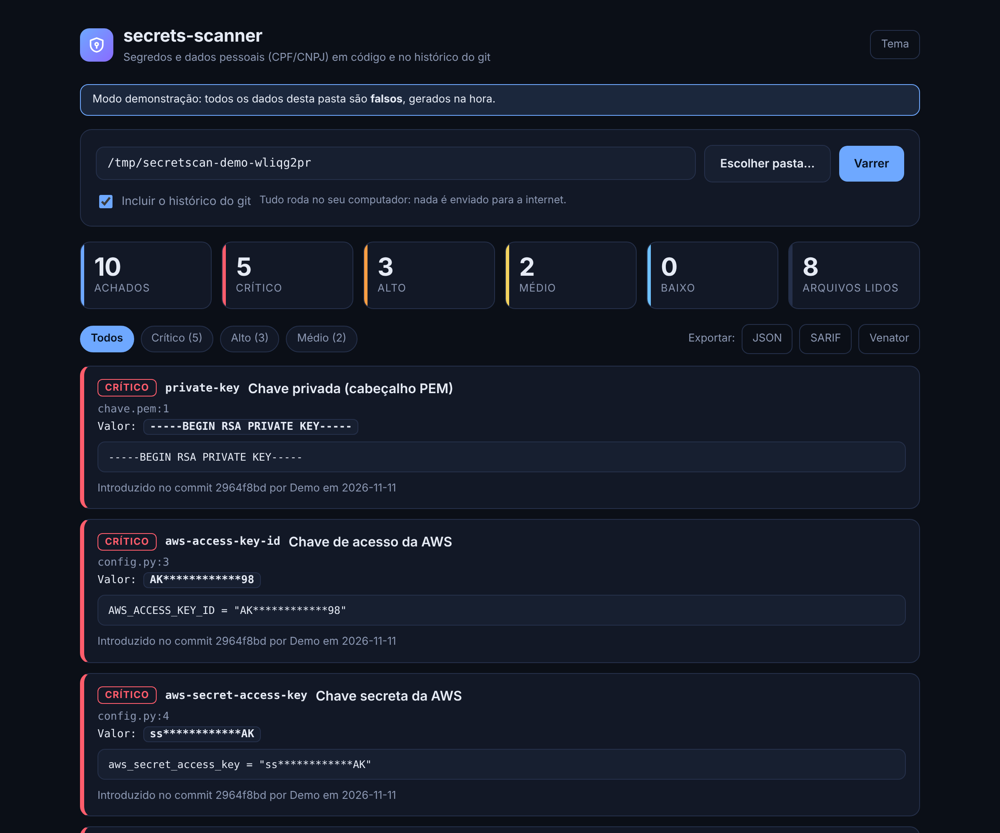

# secrets-scanner

Detector de **segredos** (chaves, tokens, senhas) e **dados pessoais** (CPF e CNPJ, para a LGPD) em código e
**no histórico do git**, com um **hook de pre-commit** que recusa o commit antes de o segredo sair do seu
computador. Python, **sem dependências externas**.

## Por que existe

Um segredo que vai para um repositório público deve ser tratado como vazado: robôs varrem o GitHub em
minutos. E apagar a linha depois não resolve, porque ela continua no histórico do git. O `secrets-scanner`
procura o segredo antes do commit e também nos commits antigos, e avisa quando ele "já foi apagado do código,
mas ainda está no histórico".

## Interface gráfica

```bash
python app.py gui                 # abre a interface no navegador
python app.py gui --demo          # com uma pasta de demonstração (dados falsos), ideal para um print
```



Uma página local: escolha a pasta, marque se quer o histórico do git e veja os achados por severidade, com o
aviso de "já apagado do código, mas ainda no histórico". Exporta JSON, SARIF e o formato do Venator.
Não precisa instalar nada e **nada sai do seu computador**: o servidor escuta só em `127.0.0.1`, confere
`Host` e `Origin` (contra DNS rebinding), exige um token aleatório a cada execução e só mostra valores
mascarados. Tem tema claro e escuro e se adapta a telas pequenas.

## Como rodar (linha de comando)

Requisito: Python 3.9 ou superior (e `git`, para histórico e hook).

```bash
python app.py scan .                      # varre a pasta
python app.py scan . --history            # varre também todos os commits
python app.py scan . --format sarif -o resultado.sarif
python app.py rules                       # lista as 23 regras
```

O comando sai com código **1** se achar algo na severidade mínima (padrão `medium`; mude com `--fail-on`),
o que serve para CI.

### Hook de pre-commit

```bash
python app.py install-hook                # no repositório atual (ou --repo CAMINHO)
```

Depois disso, `git commit` roda o scanner **só no que está no index** e recusa o commit se achar algo.
Para pular uma vez: `git commit --no-verify`. Para remover: `python app.py uninstall-hook`.
O hook nunca sobrescreve um `pre-commit` que não seja deste projeto (use `--force` se quiser).

### Falsos positivos

* Na linha: acrescente um comentário com `secretscan:ignore`.
* No projeto: `python app.py baseline` registra os achados atuais em `.secretscan-baseline.json` e o scan
  seguinte só mostra o que for novo. O arquivo guarda apenas **HMAC** dos segredos, nunca o segredo; a chave
  fica em `.git/secretscan.key` (ou `.secretscan.key`, que o `.gitignore` já exclui) e **não deve ser
  commitada**. Sem a chave, a linha de base não suprime nada.
* Arquivos: `--exclude "tests/*"` (repetível).

## Regras

| Regra | O que detecta | Severidade |
|---|---|---|
| `aws-access-key-id` | Chave de acesso da AWS | critical |
| `aws-secret-access-key` | Chave secreta da AWS | critical |
| `github-token` | Token do GitHub | critical |
| `github-fine-grained-pat` | Token granular do GitHub | critical |
| `gitlab-pat` | Token pessoal do GitLab | critical |
| `slack-token` | Token do Slack | critical |
| `slack-webhook` | Webhook do Slack | high |
| `google-api-key` | Chave de API do Google | high |
| `stripe-live-key` | Chave secreta do Stripe (produção) | critical |
| `twilio-api-key` | Chave de API do Twilio | high |
| `sendgrid-api-key` | Chave de API do SendGrid | critical |
| `openai-api-key` | Chave de API da OpenAI | critical |
| `anthropic-api-key` | Chave de API da Anthropic | critical |
| `npm-token` | Token do npm | critical |
| `private-key` | Chave privada (cabeçalho PEM) | critical |
| `jwt` | JSON Web Token | medium |
| `url-credentials` | Senha dentro de uma URL | high |
| `password-assignment` | Senha ou segredo escrito no código | high |
| `high-entropy-secret` | Valor aleatório em variável de segredo | medium |
| `azure-storage-key` | Chave de conta de armazenamento do Azure | critical |
| `telegram-bot-token` | Token de bot do Telegram | high |
| `cpf` | CPF válido (LGPD) | medium |
| `cnpj` | CNPJ válido (LGPD) | medium |

CPF e CNPJ só são reportados se os **dígitos verificadores** baterem. Sem pontuação, só quando a linha
contém a palavra `cpf` ou `cnpj`.

## Formatos de saída

| `--format` | Uso |
|---|---|
| `text` | leitura no terminal (padrão) |
| `json` | automação |
| `sarif` | GitHub code scanning |
| `venator` | JSONL no formato genérico que o painel **Venator** já importa |

**Nenhum formato mostra um segredo inteiro**: só uma versão mascarada, e o trecho da linha vem com todos os
segredos dela mascarados. Um teste confere isso nos quatro formatos e na linha de base.

### Levar para o Venator

```bash
python app.py scan . --history --format venator -o secretscan.jsonl
# no Venator:
python app.py import ../secrets-scanner/secretscan.jsonl
```

## Como funciona

* **Arquivos**: lê o texto linha a linha (linhas gigantes, como JS minificado, em janelas com sobreposição).
  Ignora `.git`, `node_modules`, `.venv` e similares, binários, arquivos acima de 1 MiB e links simbólicos.
* **Histórico**: `git log --all -p -U0` e lê só as linhas **adicionadas**. Cada segredo é reportado uma vez,
  no commit mais antigo que o introduziu, com autor e data, e marcado se já saiu do código.
* **Hook**: `git diff --cached -U0` e o mesmo leitor; o script é gravado com quebras de linha LF e tenta
  `python3`, `python` e `py`. Se não achar Python, **recusa** o commit (falha fechada).
* **Expressões regulares**: todas com quantificadores limitados; os testes as exercitam com entradas de 100
  mil caracteres feitas para provocar backtracking.

## Limites (leia antes de confiar)

* É **heurística**: tem falsos positivos e falsos negativos. "Nada encontrado" não prova que não há segredos.
* Só olha o **formato** da chave; **não verifica se ela ainda está ativa**.
* Não lê arquivos em UTF-16 nem binários (e ignora arquivos acima de 1 MiB).
* Senhas só são vistas em atribuições com aspas (`senha = "..."`, `"password": "..."`) ou em linhas de
  `.env` em MAIÚSCULAS; `senha = variavel` ou segredos montados em partes passam.
* O hook pode ser contornado com `--no-verify` e só vale na sua cópia do repositório: não substitui uma
  verificação no servidor (CI).
* Um segredo achado no histórico exige **trocar a credencial**; reescrever o histórico não desfaz um vazamento
  que já foi público.

## Testes

```bash
python -m unittest discover -s tests
```

Cobrem: as 23 regras (uma amostra de cada), falsos positivos reais, validadores de CPF/CNPJ contra 1500
números gerados de forma independente, entradas contra ReDoS, repositórios git de verdade (histórico, index e o
hook recusando um commit real), linha de base, relatórios e um **autoexame**: o projeto varre a si mesmo e não
pode se acusar. Os segredos de teste são montados em tempo de execução, nunca escritos por extenso.

## Estrutura

```
app.py                 ponto de entrada
secretscan/
  rules.py             as regras e os filtros de falso positivo
  validators.py        CPF, CNPJ e entropia
  scanner.py           arquivos, index do git e histórico
  baseline.py          linha de base com HMAC
  report.py            texto, JSON, SARIF e Venator
  gui.py               interface gráfica local (servidor em 127.0.0.1)
  web/index.html       a página da interface
  demo.py              pasta de demonstração com dados falsos
  hook.py              instalação do pre-commit
  cli.py               linha de comando
tests/
docs/                  imagem da interface
```
